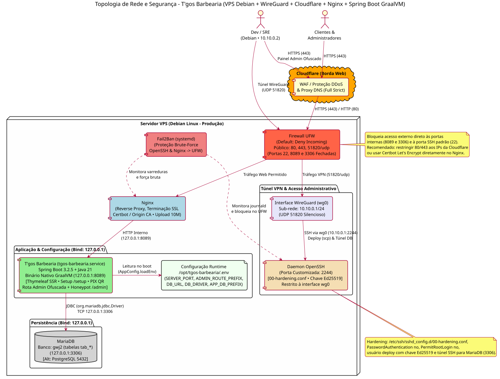

# 🌐 Topologia de Rede, Proxy Reverso, VPN e Segurança Perimetral, T'gos Barbearia

Este documento descreve a arquitetura de rede, túnel VPN privado (**WireGuard**), hardening de **SSH**, exposição controlada de portas, terminação SSL/TLS e camadas de defesa aplicadas ao servidor de produção (**VPS Debian Linux**) da aplicação **T'gos Barbearia (`com.gwj:projeto`)**, compilada com **GraalVM Native Image** (Java 21 + Spring Boot 3.2.5).



---

## 1. Visão Geral da Arquitetura

O tráfego externo passa por múltiplas camadas de filtragem antes de atingir o binário nativo **TGOS Barbearia** (`tgos-barbearia`, executando sob `systemd` em `127.0.0.1:8089`). Nenhum banco de dados ou porta da aplicação é exposto diretamente na internet: o tráfego web entra exclusivamente pelo **Nginx** (opcionalmente atrás da **Cloudflare**), e o acesso administrativo (**SSH** e **deploy**) opera apenas por túnel **WireGuard (`wg0`)** com porta customizada e autenticação exclusiva por chave.

### Fluxo de Requisições e Acesso

1. **Borda Externa Web (Cloudflare / DNS):** Filtra tráfego malicioso (WAF/DDoS), oculta o IP real da VPS e encaminha requisições HTTPS para a porta `443` em modo *Full (Strict)*. *(Caso não utilize proxy da Cloudflare, o próprio Nginx realiza a terminação HTTPS com certificado Let's Encrypt via Certbot.)*
2. **Firewall de Host (UFW):** Opera com política padrão `deny incoming`, liberando publicamente apenas `80/tcp` (HTTP), `443/tcp` (HTTPS) e `51820/udp` (túnel WireGuard). A porta padrão `22` permanece fechada, assim como as portas internas `8089` (Spring Boot) e `3306` (MariaDB).
3. **Túnel VPN Privado (WireGuard `wg0`, `10.10.0.1/24`):** Cria um túnel ponto-a-ponto direto no kernel entre a estação Debian do administrador/desenvolvedor (`10.10.0.2`) e a VPS (`10.10.0.1`) via pacotes UDP silenciosos (`51820/udp`), tornando o SSH invisível para *scanners* da internet pública.
4. **Acesso Administrativo & Hardening SSH (`00-hardening.conf`):**
   * Usa porta customizada (ex.: `2244`, gerenciada via `ssh.socket` / `ssh.service`) e prefixo `00-` em `/etc/ssh/sshd_config.d/00-hardening.conf` para garantir precedência sobre `50-cloud-init.conf`.
   * Exige chave assimétrica (`Ed25519`), bloqueia autenticação por senha (`PasswordAuthentication no`) e proíbe login direto como `root` (`PermitRootLogin no`), utilizando usuário dedicado para deploy e manutenção.
5. **Prevenção de Intrusão (Fail2Ban):** Monitora o `journald` (`backend = systemd`) para OpenSSH e logs do Nginx, aplicando banimentos dinâmicos no UFW contra força bruta e varreduras.
6. **Proxy Reverso & Edge Defense (Nginx):**
   * Realiza a terminação SSL/TLS na porta `443` e redireciona HTTP (`80`) para HTTPS (`301`).
   * Define `client_max_body_size 10M` (upload de imagens de produtos e serviços) e encaminha requisições internamente para `http://127.0.0.1:8089` preservando `Host`, `X-Real-IP`, `X-Forwarded-For` e `X-Forwarded-Proto`.
7. **Aplicação Spring Boot Nativa (GraalVM) & Defesa em Profundidade:**
   * O executável `/opt/tgos-barbearia/tgos-barbearia` (`com.gwj.StartApplication`, gerenciado pelo serviço `tgos-barbearia.service` como usuário `www-data`) escuta apenas em `127.0.0.1:8089` (`SERVER_HOST=127.0.0.1`, `SERVER_PORT=8089`).
   * Carrega configurações em `/opt/tgos-barbearia/.env` via `com.gwj.AppConfig`, protege a área administrativa por rota ofuscada (`ADMIN_ROUTE_PREFIX`), mantém uma armadilha *Honeypot* em `/admin` (retornando `403 Forbidden` imediato) e aplica tratamento global de exceções sem expor stacktraces ao cliente (`GlobalExceptionHandler`).
   * Conecta-se ao **MariaDB** local (`127.0.0.1:3306`, banco `gwj2`, driver `org.mariadb.jdbc.Driver`).

---

## 2. Mapa de Portas e Serviços

### 2.1. Expostos Externamente (Filtrados pelo UFW)

| Porta | Protocolo | Serviço | Origem Recomendada | Finalidade |
| :--- | :--- | :--- | :--- | :--- |
| **80** | TCP (HTTP) | Nginx | IPs da Cloudflare *(ou Geral para desafio ACME)* | Redirecionamento automático (`301`) para HTTPS (`443`). |
| **443** | TCP (HTTPS) | Nginx | IPs da Cloudflare *(ou Geral)* | Ponto único de entrada web (Storefront SSR, Agendamento, Checkout/PIX e Painel Admin ofuscado). |
| **51820** | UDP | WireGuard (`wg0`) | Estação Admin | Túnel VPN criptografado silencioso (`10.10.0.2` ↔ `10.10.0.1`) para administração e deploy seguros. |
| ~~**22**~~ | TCP (SSH) | OpenSSH Daemon | **Fechada no UFW público** | Substituída por porta customizada (ex.: **`2244`**) acessível exclusivamente via interface **`wg0`** (`10.10.0.1`). |

### 2.2. Restritos à Interface VPN (`wg0`, `10.10.0.1`)

| Porta | Protocolo | Serviço | Origem Permitida | Finalidade |
| :--- | :--- | :--- | :--- | :--- |
| **2244** *(custom)* | TCP (SSH) | OpenSSH Daemon | Apenas interface `wg0` (`10.10.0.0/24`) | Administração do servidor, envio de binário/JAR via `scp` (`deploy.sh`) e túneis SSH seguros para o MariaDB (`3306`). |

### 2.3. Restritos ao Host Local (`127.0.0.1`, Loopback)

| Porta | Protocolo | Serviço | Consumidor / Acesso | Finalidade |
| :--- | :--- | :--- | :--- | :--- |
| **8089** | HTTP | **T'gos Barbearia (`tgos-barbearia.service`)** | Nginx (`proxy_pass http://127.0.0.1:8089`) | Aplicação Java 21 / Spring Boot 3.2.5 (GraalVM Native Image ou Fat JAR): Storefront Thymeleaf, Setup `/setup`, Checkout e Backoffice. |
| **3306** | TCP | **MariaDB** *(Alt.: PostgreSQL `5432`)* | Aplicação Spring Boot, Túnel SSH | Persistência relacional do banco `gwj2` (tabelas com prefixo `APP_DB_PREFIX=tab_`). |

---

## 3. Decisões de Segurança e Boas Práticas

* **Isolamento em Localhost (`127.0.0.1`):** Tanto o servidor embarcado da aplicação (`SERVER_HOST=127.0.0.1`, porta `8089`) quanto o banco **MariaDB** (`3306`) escutam exclusivamente na interface de loopback, impedindo acesso externo direto mesmo em caso de falha ou desativação temporária do UFW.
* **SSH Invisível via WireGuard + Porta Customizada:** A combinação de túnel **WireGuard (`wg0`)** com **porta SSH customizada** (`2244`) e `/etc/ssh/sshd_config.d/00-hardening.conf` elimina varreduras automatizadas e garante acesso administrativo exclusivo por chaves `Ed25519`.
* **Acesso Administrativo ao Banco via Túnel SSH sobre VPN:** Como a porta `3306` permanece restrita a `127.0.0.1`, clientes SQL locais (DBeaver, MariaDB CLI) conectam-se via túnel SSH sobre a interface `wg0` (`10.10.0.1`).
* **Ofuscação da Rota Admin + Honeypot:** A rota do painel administrativo é configurada dinamicamente via `ADMIN_ROUTE_PREFIX` no arquivo `/opt/tgos-barbearia/.env` (`WorkingDirectory=/opt/tgos-barbearia`), enquanto `/admin` e `/admin/**` funcionam como *Honeypot* devolvendo `403 Forbidden`.
* **Build Local + Deploy Seguro:** A compilação nativa **GraalVM Native Image** exige de 4 GB a 8 GB de RAM e é feita na estação Debian local (ou CI/CD), enviando apenas o binário pronto para a VPS via túnel SSH/WireGuard.
* **Certificados SSL/TLS (Full Strict ou Certbot):** Comunicação criptografada ponta a ponta com **Cloudflare Origin CA** ou certificado gratuito **Let's Encrypt** renovado automaticamente pelo Certbot.

---

## 4. Documentação Relacionada

* [Guia Completo de Deploy em VPS Debian (GraalVM Native Image / Fat JAR, Systemd, Nginx e `deploy.sh`)](../../tutoriais/app-vpn.md)
* [Arquivo de Configuração Maven (`pom.xml`)](../../../pom.xml)
* [Exemplo de Variáveis de Ambiente (`.env.example`)](../../../.env.example)

---

## 5. Manutenção deste Diagrama

O diagrama desta página é mantido como código (*Docs-as-Code*) em [`network-topology.puml`](./network-topology.puml). Sempre que houver alteração de portas, novos serviços ou mudanças nas regras de firewall:

1. Atualize o arquivo `network-topology.puml`.
2. Regenere a imagem vetorial executando na pasta:
   ```bash
   plantuml -tsvg network-topology.puml
   ```
3. Atualize as tabelas de portas e fluxos neste `README.md`.
