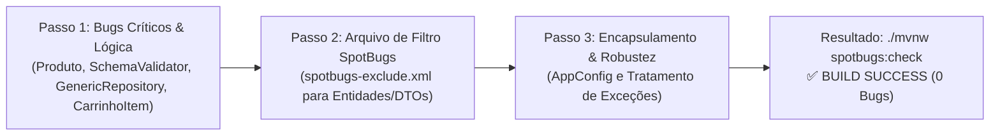

# Análise de Segurança

> A análise dos **56 apontamentos gerados pelo SpotBugs** no arquivo [exemplo-erro.md](/examples/exemplo-erro.md) revela um diagnóstico riquíssimo sob o ponto de vista de **Engenharia e Qualidade de Software**.

O SpotBugs detectou três grupos distintos de problemas: **bugs reais de lógica**, **más práticas de tratamento de erros** e **decisões arquiteturais sobre mutabilidade de entidades**.

---

## 🔍 Raio-X dos Apontamentos (Classificação Didática)

### 🔴 Grupo 1: Defeitos Reais e Críticos de Lógica (Alta Gravidade - Ação Imediata)

São bugs que podem quebrar a aplicação em tempo de execução ou abrir brechas de segurança:

1. **Auto-atribuição e leitura de campo não inicializado em [Produto.java](/src/main/java/com/gwj/model/domain/entities/Produto.java#L61):**
   - **Código atual:** `this.imagem = imagem;` dentro do construtor, mas `imagem` **não é parâmetro** do método!
   - **Efeito:** O campo faz auto-atribuição de si mesmo (`this.imagem = this.imagem`) antes mesmo de existir (`UR_UNINIT_READ` e `SA_FIELD_SELF_ASSIGNMENT`). O atributo sempre fica nulo.
2. **Serialização inconsistente em `CarrinhoItem.java` (`SE_BAD_FIELD`):**
   - A classe implementa `Serializable` para ser salva na `HttpSession`, mas o campo `produto` não é `Serializable` nem `transient`. Se o Tomcat for reiniciar ou serializar sessões em disco, lançará `NotSerializableException`.
3. **Concatenação de SQL em `CheckEnvironment.java:[line 324]` (`SQL_NONCONSTANT_STRING_PASSED_TO_EXECUTE`):**
   - Execução de consulta com String dinâmica sem `PreparedStatement`, abrindo risco de injeção de SQL.

---

### 🟡 Grupo 2: Qualidade de Código e Fragilidade de Execução (Média Gravidade)

Defeitos que deixam o sistema frágil ou com código "morto":

1. **Risco de `NullPointerException` e lógica morta em [SchemaValidator.java](/src/main/java/com/gwj/model/domain/factory/SchemaValidator.java#L86-L105):**
   - `directory.listFiles()`: Se houver falha de leitura em disco, o método retorna `null` e o `for` explode em `NullPointerException`.
   - `!method.getName().endsWith("Id")`: O retorno booleano é avaliado mas o corpo do `if` está vazio (apenas um comentário), gerando `RV_RETURN_VALUE_IGNORED`.
2. **Objeto inútil alocado na memória em [GenericRepository.java](/src/main/java/com/gwj/model/repository/GenericRepository.java#L48):**
   - A lista `ArrayList<String> placeholders` é instanciada e alimentada com `"?"`, mas o [QueryBuilder](/src/main/java/com/gwj/model/repository/GenericRepository.java#L73) gera os placeholders sozinho a partir de `columns`. Trata-se de código morto (`UC_USELESS_OBJECT`).
3. **Captura inútil de exceções (`REC_CATCH_EXCEPTION`):**
   - Em [AppConfig](/src/main/java/com/gwj/AppConfig.java#L41), `AgendamentoService` e `SetupService`, blocos `try-catch` capturam `Exception` genérica onde nenhuma exceção checada pode ser disparada.
4. **Campos primitivos públicos e mutáveis em [AppConfig.java](/src/main/java/com/gwj/AppConfig.java#L13-L18):**
   - `DB_URL`, `DB_USER`, `DB_PASS` são `public volatile`. Devem ser encapsulados com getters públicos e setters privados/controlados (`PA_PUBLIC_PRIMITIVE_ATTRIBUTE`).

---

### 🔵 Grupo 3: Exposição de Representação Interna (`EI_EXPOSE_REP` / `EI_EXPOSE_REP2`) ~ 35 ocorrências

Representa mais de **60% dos avisos** do SpotBugs:
- Ocorre em getters/setters de coleções e entidades (`Cliente.getListaEndereco()`, `Pedido.getItens()`, `Usuario.getPerfil()`).
- **Motivo:** O SpotBugs alerta que retornar a lista direta interna permite que quem chamou faça `cliente.getListaEndereco().clear()`, alterando o estado interno do objeto sem passar pelas regras de negócio da entidade.
- **Padrão da Indústria:** Em frameworks ORM e entidades de domínio JPA/JDBC, getters e setters precisam operar com referências diretas para permitir Reflection, Data Binding do Thymeleaf e Mappers. A prática padrão da indústria é **ignorar esse alerta especificamente para classes de entidade e DTOs** via filtro de exclusão (`spotbugs-exclude.xml`).

---

## 🗺️ Proposta de Plano de Ação (Próximos Passos)

Podemos organizar a correção em **3 passos cirúrgicos**:

1. **Passo 1 (Correção de Bugs Críticos):**
   - Corrigir o construtor do `Produto.java`.
   - Adicionar o `transient` ou `implements Serializable` no `CarrinhoItem`.
   - Remover a variável morta `placeholders` no `GenericRepository`.
   - Proteger o `directory.listFiles()` contra `null` e ajustar o `if` vazio no `SchemaValidator`.
2. **Passo 2 (Configuração de Filtro Profissional `spotbugs-exclude.xml`):**
   - Configurar o SpotBugs no `pom.xml` para excluir as regras de encapsulamento defensivo (`EI_EXPOSE_REP`/`EI_EXPOSE_REP2`) nas entidades do pacote `com.gwj.model.domain.entities.*`, exatamente como é feito em projetos Spring Boot corporativos.
3. **Passo 3 (Validação Final):**
   - Rodar novamente `JAVA_HOME=/usr/lib/jvm/java-21-openjdk-amd64 ./mvnw spotbugs:check` e ver a suíte alcançar **BUILD SUCCESS com 0 bugs**.

# Implementações dos passos 1, 2 e 3

* [Plano de Implementação 18](/docs/architecture/deployment/deploy-plan-018.md)
* [Caminho feliz 18](/docs/architecture/reviews/Walkthrough-018.md)
