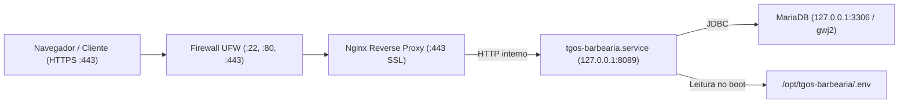

# Guia de Deploy em Produção (VPS Debian): TGOS Barbearia (`com.gwj:projeto`)

Este tutorial descreve o passo a passo completo para compilar, configurar e publicar o sistema **TGOS Barbearia** (`com.gwj:projeto`) em uma **VPS Debian Linux** utilizando **GraalVM Native Image** (ou **JVM Fat JAR otimizado** como alternativa), **MariaDB**, **Systemd**, **Nginx** e **HTTPS gratuito com Let's Encrypt**.

> [!NOTE]
> Como tanto a sua máquina de desenvolvimento quanto a VPS executam **Debian** (mesma arquitetura, ex.: `x86_64`), você pode compilar o executável localmente e enviar apenas o artefato pronto para o servidor, evitando esgotar a memória RAM da VPS durante o build.

---

## Visão Geral da Arquitetura em Produção

| Componente / Parâmetro | Valor no Projeto TGOS Barbearia |
| :--- | :--- |
| **Coordenadas Maven** | `com.gwj:projeto` (`0.0.1-SNAPSHOT`) |
| **Classe Principal (`@SpringBootApplication`)** | `com.gwj.StartApplication` |
| **Java / Spring Boot** | Java `21` LTS / Spring Boot `3.2.5` |
| **Build Tool** | Maven Wrapper (`./mvnw`) |
| **Porta Interna da Aplicação** | `8089` (`SERVER_PORT=8089`, atrás do Nginx) |
| **Banco de Dados Principal** | MariaDB 10.11+ / 11+ (`org.mariadb.jdbc.Driver`, banco `gwj2`) — suporte alternativo a PostgreSQL |
| **Configuração Dinâmica** | Arquivo `.env` carregado por `com.gwj.AppConfig` + Setup Wizard (`/setup`) |
| **Segurança do Painel Admin** | Rota ofuscada via `ADMIN_ROUTE_PREFIX` + Honeypot em `/admin` |



---

## 1. Preparando o Ambiente Local de Compilação (Debian)

Para que o GraalVM compile bytecode Java em um executável nativo Linux, ele precisa do compilador C (`gcc`) e dos cabeçalhos da biblioteca `zlib`.

### 1.1. Instalar dependências do sistema

```bash
sudo apt-get update
sudo apt-get install -y build-essential libz-dev zlib1g-dev curl zip unzip
```

### 1.2. Instalar o GraalVM 21 via SDKMAN!

A forma mais prática de gerenciar o GraalVM 21 sem interferir no OpenJDK padrão do sistema é com o **SDKMAN!**:

```bash
curl -s "https://sdkman.io" | bash
source "$HOME/.sdkman/bin/sdkman-init.sh"

# Liste as distribuições GraalVM 21 disponíveis (ex.: 21.0.2-graalce ou 21-graal)
sdk list java | grep -i graal

# Instale a distribuição escolhida (exemplo com GraalVM CE 21)
sdk install java 21.0.2-graalce
```

Valide se o JDK ativo e o compilador nativo estão funcionando:

```bash
java -version
native-image --version
```

---

## 2. Adaptando o Projeto TGOS Barbearia para GraalVM Native Image

O `spring-boot-starter-parent` (`3.2.5`) já traz o profile `native` pré-configurado. Para personalizar o nome do binário gerado e apontar explicitamente para a nossa classe principal (`com.gwj.StartApplication`), adicione a configuração do `native-maven-plugin` dentro de `<build><plugins>` no arquivo [`pom.xml`](../../pom.xml):

```xml
<plugin>
    <groupId>org.graalvm.buildtools</groupId>
    <artifactId>native-maven-plugin</artifactId>
    <configuration>
        <imageName>tgos-barbearia</imageName>
        <mainClass>com.gwj.StartApplication</mainClass>
    </configuration>
</plugin>
```

> [!IMPORTANT]
> **Ponto Crítico do Projeto — Reflexão Dinâmica e Varredura de Entidades**
>
> O motor de persistência e CRUD dinâmico do **TGOS Barbearia** (`DataMapper`, `QueryBuilder`, `EntityMapper`, `DtoMapper`, `SimpleObjectFactory`, `GenericRepository` e as entidades em `com.gwj.model.domain.entities.*`), além do `thymeleaf-layout-dialect`, fazem uso intenso de **Java Reflection** em tempo de execução. Além disso, o método `SchemaValidator.getClassesFromPackage(...)` varre arquivos `.class` diretamente no classpath durante o boot.
>
> Em compilação nativa (AOT), métodos e atributos acessados apenas via reflexão não são incluídos no binário a menos que estejam declarados em metadados de reflexão.

Você tem **duas estratégias** para lidar com isso:

### Estratégia A: Mapear Reflexão com o `native-image-agent` (Para usar Native Image)

1. Gere primeiro o JAR executável normal:
   ```bash
   ./mvnw clean package -DskipTests
   ```
2. Execute a aplicação localmente acoplada ao agente de rastreamento do GraalVM:
   ```bash
   mkdir -p src/main/resources/META-INF/native-image
   java -agentlib:native-image-agent=config-output-dir=src/main/resources/META-INF/native-image \
        -jar target/projeto-0.0.1-SNAPSHOT.jar
   ```
3. Enquanto a aplicação roda, navegue pelos fluxos principais no navegador (Home, Loja, Agendamento, Checkout/PIX, Login, `/setup` e Painel Administrativo) para que o agente registre todas as classes, campos e recursos acessados por reflexão.
4. Encerre com `Ctrl+C`. Os arquivos `reflect-config.json` e `resource-config.json` serão salvos em `src/main/resources/META-INF/native-image/` e incorporados automaticamente no próximo build nativo.

### Estratégia B: Alternativa Pragmática — Deploy via Fat JAR com Limite de RAM

Se você quiser subir rapidamente para a VPS sem precisar manter arquivos de hints AOT sempre que adicionar uma nova entidade ou biblioteca, pode gerar um **Fat JAR tradicional** e rodar com **OpenJDK 21 JRE** na VPS limitando o consumo de memória:

```bash
./mvnw clean package -DskipTests
# Gera: target/projeto-0.0.1-SNAPSHOT.jar
```

Na VPS, basta instalar `openjdk-21-jre-headless` e executar com `-Xms128m -Xmx384m -XX:+UseSerialGC` (consumindo cerca de 200 MB–350 MB de RAM).

---

## 3. Compilando o Executável Localmente

> [!WARNING]
> **Não compile em VPS pequena (1 GB ou 2 GB de RAM).** A geração da Native Image consome entre **4 GB e 8 GB de RAM** e picos elevados de CPU, podendo travar o servidor de produção. Compile sempre na sua máquina local ou em CI/CD (GitHub Actions).

Na raiz do projeto, execute o comando correspondente à estratégia escolhida:

* **Compilação Nativa Linux (GraalVM, máquina local Debian -> VPS Debian):**
  ```bash
  ./mvnw -Pnative native:compile -DskipTests
  ```
  O binário autônomo será gerado em `target/tgos-barbearia` (ou `target/projeto` caso não tenha definido `<imageName>`).

* **Compilação Nativa via Docker / Buildpacks (útil ao compilar no Windows/macOS ou outra arquitetura):**
  ```bash
  ./mvnw -Pnative spring-boot:build-image -DskipTests
  ```

* **Compilação Fat JAR Tradicional (Alternativa JVM):**
  ```bash
  ./mvnw clean package -DskipTests
  ```
  O pacote será gerado em `target/projeto-0.0.1-SNAPSHOT.jar`.

> [!TIP]
> Antes de gerar o artefato de produção, rode os testes rápidos da aplicação para garantir que nenhuma regressão está subindo:
> ```bash
> ./mvnw test -Dtest="*Test,!AgendamentoVideoE2ETest"
> ```

---

## 4. Preparando a VPS Debian

Conecte-se à sua VPS via SSH (`ssh usuario@ip-da-vps`) e prepare o banco de dados, diretórios e firewall.

### 4.1. Instalar pacotes base na VPS

```bash
sudo apt-get update && sudo apt-get upgrade -y
sudo apt-get install -y mariadb-server nginx ufw certbot python3-certbot-nginx curl
```

*(Caso utilize a **Estratégia B — Fat JAR**, instale também o runtime Java 21 sem interface gráfica: `sudo apt-get install -y openjdk-21-jre-headless`.)*

### 4.2. Configurar o MariaDB (`gwj2`)

Execute o script de segurança inicial do MariaDB (opcional, recomendado):

```bash
sudo mariadb-secure-installation
```

Acesse o console do MariaDB como root e crie o banco `gwj2` e o usuário dedicado da aplicação restrito a `localhost`:

```bash
sudo mariadb
```

```sql
CREATE DATABASE IF NOT EXISTS `gwj2`
  CHARACTER SET utf8mb4
  COLLATE utf8mb4_unicode_ci;

CREATE USER IF NOT EXISTS 'desenvolvedor'@'localhost' IDENTIFIED BY 'TroquePorUmaSenhaForte123!';
GRANT ALL PRIVILEGES ON `gwj2`.* TO 'desenvolvedor'@'localhost';
FLUSH PRIVILEGES;
EXIT;
```

> [!NOTE]
> Você não precisa importar o SQL manualmente se for usar o **Setup Wizard (`/setup`)** no primeiro acesso: o sistema criará as tabelas de `gwj5.sql`, garantirá os índices no `SchemaValidator` e cadastrará o superusuário administrador. Se preferir importar antes manualmente, envie [`gwj5.sql`](../../gwj5.sql) e execute `mariadb -u desenvolvedor -p gwj2 < gwj5.sql`.

### 4.3. Criar diretório da aplicação e arquivo `.env`

```bash
sudo mkdir -p /opt/tgos-barbearia
sudo chown -R www-data:www-data /opt/tgos-barbearia
```

Crie o arquivo `/opt/tgos-barbearia/.env` (utilizado pelo `AppConfig.loadEnv()`):

```bash
sudo nano /opt/tgos-barbearia/.env
```

Cole o conteúdo abaixo ajustando a senha do banco e o prefixo secreto do painel administrativo:

```dotenv
# ===================================================================
# Variáveis de Produção - TGOS Barbearia (/opt/tgos-barbearia/.env)
# ===================================================================
APP_ENV=production
APP_DEBUG=false

# Porta interna (acessada apenas via Nginx Reverse Proxy)
SERVER_HOST=127.0.0.1
SERVER_PORT=8089

# Rota ofuscada do Painel Administrativo (nunca use /admin em produção)
ADMIN_ROUTE_PREFIX=adm_6b85358db772

# Banco de Dados (use org.mariadb.jdbc.Driver, pois é o driver presente no pom.xml)
DB_DRIVER=org.mariadb.jdbc.Driver
DB_URL=jdbc:mariadb://localhost:3306/gwj2?allowPublicKeyRetrieval=true&useSSL=false
DB_USERNAME=desenvolvedor
DB_PASSWORD=TroquePorUmaSenhaForte123!

# Prefixo de tabelas e mapeamento de entidades
APP_DB_PREFIX=tab_
APP_ENTITY_PACKAGE=com.gwj.model.domain
APP_ENTITIES_PATH=com.gwj.model.domain.entities
```

Proteja as permissões do `.env` para que apenas `www-data` (e `root`) possa lê-lo e atualizá-lo caso utilize o `/setup`:

```bash
sudo chown www-data:www-data /opt/tgos-barbearia/.env
sudo chmod 600 /opt/tgos-barbearia/.env
```

> [!TIP]
> Se desejar realizar a configuração inicial pela interface web em `https://barbearia.seudominio.com.br/setup`, deixe a pasta `/opt/tgos-barbearia` com dono `www-data:www-data` e suba sem criar o `.env` manualmente — o **Setup Wizard** gravará o `.env` automaticamente ao concluir a instalação.

---

## 5. Configurando o Serviço em Segundo Plano (Systemd)

### 5.1. Enviar o artefato inicial para a VPS

Da sua máquina local Debian (na raiz do projeto):

```bash
# Se compilou com GraalVM Native Image:
scp target/tgos-barbearia usuario@ip-da-vps:/tmp/tgos-barbearia

# Conecte na VPS para mover e ajustar permissões:
ssh usuario@ip-da-vps "sudo mv /tmp/tgos-barbearia /opt/tgos-barbearia/tgos-barbearia && \
  sudo chown www-data:www-data /opt/tgos-barbearia/tgos-barbearia && \
  sudo chmod +x /opt/tgos-barbearia/tgos-barbearia"
```

*(Na **Estratégia B — Fat JAR**, envie `target/projeto-0.0.1-SNAPSHOT.jar` para `/opt/tgos-barbearia/projeto-0.0.1-SNAPSHOT.jar` com dono `www-data:www-data`.)*

### 5.2. Criar a unit `tgos-barbearia.service`

Na VPS, crie o arquivo de serviço do Systemd:

```bash
sudo nano /etc/systemd/system/tgos-barbearia.service
```

Cole a configuração abaixo. O `WorkingDirectory=/opt/tgos-barbearia` é **obrigatório**, pois o `AppConfig.loadEnv()` busca `.env` no diretório de trabalho atual:

```ini
[Unit]
Description=TGOS Barbearia - Aplicacao Spring Boot (com.gwj.StartApplication)
After=network.target mariadb.service
Wants=mariadb.service

[Service]
User=www-data
Group=www-data
WorkingDirectory=/opt/tgos-barbearia
EnvironmentFile=-/opt/tgos-barbearia/.env

# Para GraalVM Native Image:
ExecStart=/opt/tgos-barbearia/tgos-barbearia

# Alternativa caso use Fat JAR (comente a linha acima e descomente esta):
# ExecStart=/usr/bin/java -Xms128m -Xmx384m -XX:+UseSerialGC -jar /opt/tgos-barbearia/projeto-0.0.1-SNAPSHOT.jar

SuccessExitStatus=143
Restart=always
RestartSec=5
StandardOutput=journal
StandardError=journal

[Install]
WantedBy=multi-user.target
```

Ative e inicie o serviço:

```bash
sudo systemctl daemon-reload
sudo systemctl enable tgos-barbearia
sudo systemctl start tgos-barbearia
```

Verifique o status e acompanhe os logs em tempo real:

```bash
sudo systemctl status tgos-barbearia
sudo journalctl -u tgos-barbearia -f
```

---

## 6. Proxy Reverso com Nginx, Firewall (UFW) e HTTPS (SSL)

Nunca exponha a porta `8089` nem a porta `3306` diretamente na internet. Deixe apenas o Nginx recebendo tráfego nas portas `80`/`443` e encaminhando internamente para `127.0.0.1:8089`.

### 6.1. Criar o Virtual Host no Nginx

```bash
sudo nano /etc/nginx/sites-available/tgos-barbearia
```

```nginx
server {
    listen 80;
    server_name barbearia.seudominio.com.br www.barbearia.seudominio.com.br;

    # Tamanho máximo de upload (ex.: imagens de produtos/serviços)
    client_max_body_size 10M;

    location / {
        proxy_pass http://127.0.0.1:8089;
        proxy_http_version 1.1;

        proxy_set_header Host $host;
        proxy_set_header X-Real-IP $remote_addr;
        proxy_set_header X-Forwarded-For $proxy_add_x_forwarded_for;
        proxy_set_header X-Forwarded-Proto $scheme;

        proxy_connect_timeout 60s;
        proxy_read_timeout 60s;
    }
}
```

Ative a configuração, remova o site default (se não for utilizado), valide a sintaxe e recarregue o Nginx:

```bash
sudo ln -s /etc/nginx/sites-available/tgos-barbearia /etc/nginx/sites-enabled/
sudo rm -f /etc/nginx/sites-enabled/default
sudo nginx -t
sudo systemctl reload nginx
```

### 6.2. Configurar o Firewall (UFW)

```bash
sudo ufw allow OpenSSH
sudo ufw allow 'Nginx Full'
sudo ufw enable
sudo ufw status verbose
```

Com isso, as portas `8089` (Spring Boot) e `3306` (MariaDB) permanecem fechadas para acesso externo.

### 6.3. Ativar HTTPS gratuito com Certbot (Let's Encrypt)

Com o DNS do domínio `barbearia.seudominio.com.br` apontado para o IP público da VPS, emita e configure o certificado SSL automaticamente:

```bash
sudo certbot --nginx -d barbearia.seudominio.com.br -d www.barbearia.seudominio.com.br
```

Teste a renovação automática do certificado:

```bash
sudo certbot renew --dry-run
```

---

## 7. Script Automatizado de Atualização (`deploy.sh`)

Para automatizar futuras atualizações a partir da sua máquina local Debian, você pode criar um script `deploy.sh` na raiz do repositório (lembre-se de mantê-lo fora de dados sensíveis ou usar variáveis de ambiente):

```bash
#!/usr/bin/env bash
set -euo pipefail

VPS_USER="usuario"
VPS_HOST="ip-da-vps"
REMOTE_DIR="/opt/tgos-barbearia"
SERVICE_NAME="tgos-barbearia"
BIN_NAME="tgos-barbearia"
LOCAL_BIN="target/${BIN_NAME}"

echo "==> [1/4] Executando testes rápidos..."
./mvnw test -Dtest="*Test,!AgendamentoVideoE2ETest"

echo "==> [2/4] Compilando executável nativo (GraalVM)..."
./mvnw -Pnative native:compile -DskipTests

if [[ ! -f "${LOCAL_BIN}" ]]; then
  echo "Erro: binário '${LOCAL_BIN}' não encontrado."
  exit 1
fi

echo "==> [3/4] Enviando binário para a VPS (${VPS_HOST})..."
scp "${LOCAL_BIN}" "${VPS_USER}@${VPS_HOST}:/tmp/${BIN_NAME}.new"

echo "==> [4/4] Atualizando serviço e validando resposta HTTP..."
ssh "${VPS_USER}@${VPS_HOST}" bash -s <<EOF
set -euo pipefail
if [[ -f "${REMOTE_DIR}/${BIN_NAME}" ]]; then
  sudo cp "${REMOTE_DIR}/${BIN_NAME}" "${REMOTE_DIR}/${BIN_NAME}.bak"
fi
sudo mv "/tmp/${BIN_NAME}.new" "${REMOTE_DIR}/${BIN_NAME}"
sudo chown www-data:www-data "${REMOTE_DIR}/${BIN_NAME}"
sudo chmod +x "${REMOTE_DIR}/${BIN_NAME}"
sudo systemctl restart "${SERVICE_NAME}"
sleep 3

if ! curl -fsS -o /dev/null http://127.0.0.1:8089/; then
  echo "Falha no healthcheck local! Revertendo backup..."
  if [[ -f "${REMOTE_DIR}/${BIN_NAME}.bak" ]]; then
    sudo mv "${REMOTE_DIR}/${BIN_NAME}.bak" "${REMOTE_DIR}/${BIN_NAME}"
    sudo systemctl restart "${SERVICE_NAME}"
  fi
  exit 1
fi
echo "Deploy concluído com sucesso! Serviço online na porta 8089."
EOF
```

Para tornar o script executável localmente:

```bash
chmod +x deploy.sh
./deploy.sh
```

> [!TIP]
> Se você optar pela **Estratégia B (Fat JAR)**, basta trocar no `deploy.sh` o comando de compilação para `./mvnw clean package -DskipTests` e definir `BIN_NAME="projeto-0.0.1-SNAPSHOT.jar"` (removendo o `chmod +x`).

---

## 8. Troubleshooting (Resolução de Problemas Comuns)

| Sintoma / Erro | Causa Provável | Solução |
| :--- | :--- | :--- |
| `ClassNotFoundException: com.mysql.cj.jdbc.Driver` | `DB_DRIVER` configurado para MySQL no `.env`, mas o `pom.xml` usa `mariadb-java-client`. | Defina `DB_DRIVER=org.mariadb.jdbc.Driver` e `DB_URL=jdbc:mariadb://localhost:3306/gwj2?allowPublicKeyRetrieval=true&useSSL=false` no `.env`. |
| `RSA public key is not available client side` | Políticas de autenticação do banco sem SSL/chave pública em cliente JDBC. | Mantenha `?allowPublicKeyRetrieval=true&useSSL=false` na string `DB_URL`. |
| `BindException: Address already in use` na porta `8089` | Outro processo já está ouvindo na porta `8089`. | Identifique com `sudo ss -tulpn 'sport = :8089'` e encerre o processo antigo ou altere `SERVER_PORT` no `.env` e no Nginx. |
| Erro de permissão ao finalizar `/setup` | O usuário `www-data` não tem permissão de escrita em `/opt/tgos-barbearia/.env`. | Execute `sudo chown -R www-data:www-data /opt/tgos-barbearia` e reinicie o serviço. |
| `ClassNotFoundException` / falha de binding no Thymeleaf em **Native Image** | Classe de entidade (`com.gwj.model.domain.entities.*`) ou getter/setter sem metadata de reflexão no build AOT. | Rode novamente com `-agentlib:native-image-agent=...` percorrendo a tela afetada ou utilize a **Estratégia B (Fat JAR)**. |
| Erro `502 Bad Gateway` no Nginx | O serviço `tgos-barbearia` ainda está iniciando ou caiu. | Rode `sudo systemctl status tgos-barbearia` e `sudo journalctl -u tgos-barbearia -n 50 --no-pager` para ver o erro exato no boot. |
