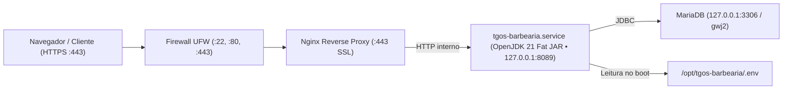

# Guia de Deploy em Produção via Fat JAR (VPS Debian): TGOS Barbearia (`com.gwj:projeto`)

Este tutorial descreve o passo a passo completo para empacotar, configurar e publicar o sistema **TGOS Barbearia** (`com.gwj:projeto`) em uma **VPS Debian Linux** utilizando **Fat JAR executável** com **OpenJDK 21 JRE** otimizado para baixo consumo de RAM, **MariaDB**, **Systemd**, **Nginx** e **HTTPS gratuito com Let's Encrypt**.

> [!NOTE]
> **Por que escolher o Fat JAR?**  
> Diferente da compilação nativa (GraalVM Native Image), o **Fat JAR** executa na JVM padrão (`openjdk-21-jre-headless`) e suporta nativamente toda a reflexão dinâmica do projeto (`DataMapper`, `EntityMapper`, `SimpleObjectFactory`, `SchemaValidator` e `thymeleaf-layout-dialect`), sem exigir manutenção de metadados AOT. Além disso, o mesmo `.jar` compilado no Windows, macOS ou Linux funciona diretamente na VPS Debian.

---

## Visão Geral da Arquitetura em Produção

| Componente / Parâmetro | Valor no Projeto TGOS Barbearia (Fat JAR) |
| :--- | :--- |
| **Coordenadas Maven** | `com.gwj:projeto` (`0.0.1-SNAPSHOT`) |
| **Artefato Gerado** | `target/projeto-0.0.1-SNAPSHOT.jar` |
| **Classe Principal (`@SpringBootApplication`)** | `com.gwj.StartApplication` |
| **Runtime na VPS** | OpenJDK `21` LTS (`openjdk-21-jre-headless`) |
| **Parâmetros JVM Recomendados (VPS 1 GB–2 GB)** | `-Xms128m -Xmx384m -XX:+UseSerialGC` |
| **Porta Interna da Aplicação** | `8089` (`SERVER_PORT=8089`, atrás do Nginx) |
| **Banco de Dados Principal** | MariaDB 10.11+ / 11+ (`org.mariadb.jdbc.Driver`, banco `gwj2`), suporte alternativo a PostgreSQL |
| **Configuração Dinâmica** | Arquivo `.env` carregado por `com.gwj.AppConfig` + Setup Wizard (`/setup`) |
| **Segurança do Painel Admin** | Rota ofuscada via `ADMIN_ROUTE_PREFIX` + Honeypot em `/admin` |



---

## 1. Preparando o Ambiente Local de Build

Para gerar o Fat JAR na sua máquina local (Linux, macOS ou Windows), você precisa apenas do **JDK 21** instalado (não é necessário instalar GraalVM, `gcc`, `zlib` nem ferramentas de compilação C).

Valide a versão do Java na sua máquina:

```bash
java -version
# Deve exibir Java 21 (ex.: openjdk version "21.x.x")
```

---

## 2. Gerando o Fat JAR Localmente (`projeto-0.0.1-SNAPSHOT.jar`)

> [!TIP]
> Antes de empacotar para produção, execute os testes unitários e de controllers para garantir que nenhuma regressão está subindo:
> ```bash
> ./mvnw test -Dtest="*Test,!AgendamentoVideoE2ETest"
> ```

Na raiz do projeto, execute o empacotamento com o Maven Wrapper (`./mvnw` no Linux/macOS ou `mvnw.cmd` no Windows):

```bash
./mvnw clean package -DskipTests
```

Ao final do build:
* O artefato executável estará em **`target/projeto-0.0.1-SNAPSHOT.jar`** (empacotado pelo `spring-boot-maven-plugin` com todas as dependências dentro de `BOOT-INF/lib/`).
* *(Ignore o arquivo `target/projeto-0.0.1-SNAPSHOT.jar.original`, que não contém as dependências embarcadas.)*

> [!WARNING]
> Evite rodar `./mvnw package` dentro de uma VPS pequena (1 GB de RAM) caso já haja banco de dados e aplicação rodando nela. Gere o `.jar` localmente (ou via GitHub Actions) e transfira apenas o arquivo pronto para o servidor.

---

## 3. Preparando a VPS Debian

Conecte-se à sua VPS via SSH (`ssh usuario@ip-da-vps`) e prepare o Java JRE 21, o banco de dados, os diretórios e as permissões.

### 3.1. Instalar Java 21 JRE e pacotes base na VPS

```bash
sudo apt-get update && sudo apt-get upgrade -y
sudo apt-get install -y openjdk-21-jre-headless mariadb-server nginx ufw certbot python3-certbot-nginx curl
```

Confirme o caminho do binário `java` (usado depois no `ExecStart` do Systemd):

```bash
which java
java -version
# Esperado: /usr/bin/java e openjdk version "21.x.x"
```

### 3.2. Configurar o MariaDB (`gwj2`)

Execute o script de segurança inicial do MariaDB (opcional, recomendado):

```bash
sudo mariadb-secure-installation
```

Acesse o console do MariaDB como root e crie o banco `gwj2` e o usuário dedicado da aplicação restrito a `localhost`:

```bash
sudo mariadb
```

```sql
CREATE DATABASE IF NOT EXISTS `gwj2`
  CHARACTER SET utf8mb4
  COLLATE utf8mb4_unicode_ci;

CREATE USER IF NOT EXISTS 'desenvolvedor'@'localhost' IDENTIFIED BY 'TroquePorUmaSenhaForte123!';
GRANT ALL PRIVILEGES ON `gwj2`.* TO 'desenvolvedor'@'localhost';
FLUSH PRIVILEGES;
EXIT;
```

> [!NOTE]
> Você não precisa importar o SQL manualmente se for usar o **Setup Wizard (`/setup`)** no primeiro acesso: o sistema criará as tabelas de `gwj5.sql`, garantirá os índices no `SchemaValidator` e cadastrará o superusuário administrador. Se preferir importar antes manualmente, envie [`gwj5.sql`](../../gwj5.sql) e execute `mariadb -u desenvolvedor -p gwj2 < gwj5.sql`.

### 3.3. Criar diretório da aplicação e arquivo `.env`

```bash
sudo mkdir -p /opt/tgos-barbearia
sudo chown -R www-data:www-data /opt/tgos-barbearia
```

Crie o arquivo `/opt/tgos-barbearia/.env` (lido tanto pelo `EnvironmentFile` do Systemd quanto pelo `AppConfig.loadEnv()`):

```bash
sudo nano /opt/tgos-barbearia/.env
```

Cole o conteúdo abaixo ajustando a senha do banco e o prefixo secreto do painel administrativo:

```dotenv
# ===================================================================
# Variáveis de Produção - TGOS Barbearia (/opt/tgos-barbearia/.env)
# ===================================================================
APP_ENV=production
APP_DEBUG=false

# Porta interna (acessada apenas via Nginx Reverse Proxy)
SERVER_HOST=127.0.0.1
SERVER_PORT=8089
SESSION_COOKIE_SECURE=true

# Rota ofuscada do Painel Administrativo (nunca use /admin em produção)
ADMIN_ROUTE_PREFIX=adm_6b85358db772

# Banco de Dados (use org.mariadb.jdbc.Driver, pois é o driver presente no pom.xml)
DB_DRIVER=org.mariadb.jdbc.Driver
DB_URL=jdbc:mariadb://localhost:3306/gwj2?allowPublicKeyRetrieval=true&useSSL=false
DB_USERNAME=desenvolvedor
DB_PASSWORD=TroquePorUmaSenhaForte123!

# Prefixo de tabelas e mapeamento de entidades
APP_DB_PREFIX=tab_
APP_ENTITY_PACKAGE=com.gwj.model.domain
APP_ENTITIES_PATH=com.gwj.model.domain.entities
```

> [!IMPORTANT]
> **Formato do `.env` para o Systemd:**  
> O `systemd` não interpreta comandos de shell dentro do `EnvironmentFile` (como `export VAR=valor` ou aspas complexas). Utilize apenas o formato simples `CHAVE=valor` em cada linha.

Proteja as permissões do `.env`:

```bash
sudo chown www-data:www-data /opt/tgos-barbearia/.env
sudo chmod 600 /opt/tgos-barbearia/.env
```

> [!TIP]
> Se desejar realizar a configuração inicial pela interface web em `https://barbearia.seudominio.com.br/setup`, deixe a pasta `/opt/tgos-barbearia` com dono `www-data:www-data` e suba sem criar o `.env` manualmente — o **Setup Wizard** gravará o `.env` automaticamente ao concluir a instalação.

---

## 4. Enviando o Fat JAR e Configurando o Serviço (Systemd)

### 4.1. Enviar o `.jar` inicial para a VPS

Da sua máquina local (na raiz do projeto):

```bash
scp target/projeto-0.0.1-SNAPSHOT.jar usuario@ip-da-vps:/tmp/projeto-0.0.1-SNAPSHOT.jar

ssh usuario@ip-da-vps "sudo mv /tmp/projeto-0.0.1-SNAPSHOT.jar /opt/tgos-barbearia/projeto-0.0.1-SNAPSHOT.jar && \
  sudo chown -R www-data:www-data /opt/tgos-barbearia"
```

### 4.2. Criar a unit `/etc/systemd/system/tgos-barbearia.service`

Na VPS, crie (ou substitua) o arquivo de serviço do Systemd:

```bash
sudo nano /etc/systemd/system/tgos-barbearia.service
```

Cole a configuração abaixo. O `WorkingDirectory=/opt/tgos-barbearia` é **obrigatório**, pois o `AppConfig.loadEnv()` busca `.env` no diretório de trabalho atual:

```ini
[Unit]
Description=TGOS Barbearia - Aplicacao Spring Boot (com.gwj.StartApplication)
After=network.target mariadb.service
Wants=mariadb.service

[Service]
User=www-data
Group=www-data
WorkingDirectory=/opt/tgos-barbearia
EnvironmentFile=-/opt/tgos-barbearia/.env

ExecStart=/usr/bin/java -Xms128m -Xmx384m -XX:+UseSerialGC -jar /opt/tgos-barbearia/projeto-0.0.1-SNAPSHOT.jar

# Alternativa caso migre para GraalVM Native Image no futuro:
# ExecStart=/opt/tgos-barbearia/tgos-barbearia

SuccessExitStatus=143
Restart=always
RestartSec=10
StandardOutput=journal
StandardError=journal

[Install]
WantedBy=multi-user.target
```

> [!NOTE]
> **Ajuste de Memória (`-Xms` / `-Xmx`):**
> * **VPS de 1 GB de RAM (com MariaDB local):** `-Xms128m -Xmx384m -XX:+UseSerialGC` mantém a JVM enxuta sem disputar memória com o MariaDB.
> * **VPS de 2 GB+ de RAM:** Você pode ampliar para `-Xms256m -Xmx512m` (ou `-Xmx768m` com G1GC padrão removendo `-XX:+UseSerialGC`).

### 4.3. Checklist rápido antes de iniciar

Como você definiu `User=www-data` e um arquivo `.env`, garanta dois detalhes para evitar erros de permissão ou leitura:

1. **Permissões da pasta:** O usuário `www-data` precisa ter permissão de leitura no `.jar` e leitura/escrita no `.env` e na pasta `/opt/tgos-barbearia` (necessário caso use o `/setup` ou salve arquivos localmente):
   ```bash
   sudo chown -R www-data:www-data /opt/tgos-barbearia
   sudo chmod 600 /opt/tgos-barbearia/.env
   ```
2. **Formato do `.env`:** Confira se não há `export ` antes das variáveis em `/opt/tgos-barbearia/.env`.

Depois de salvar o arquivo de serviço, recarregue o Systemd, habilite e inicie:

```bash
sudo systemctl daemon-reload
sudo systemctl enable --now tgos-barbearia
sudo systemctl status tgos-barbearia
```

Para acompanhar os logs em tempo real:

```bash
sudo journalctl -u tgos-barbearia -f
```

---

## 5. Proxy Reverso com Nginx (Sempre HTTPS), Cloudflare Full (Strict) e Firewall (UFW)

Nunca exponha a porta `8089` nem a porta `3306` diretamente na internet. Deixe apenas o Nginx recebendo tráfego na porta `443` (HTTPS), redirecionando qualquer requisição HTTP (`80`) para `https://` (`301`) e encaminhando internamente para `127.0.0.1:8089`.

> [!IMPORTANT]
> **Configuração Obrigatória na Cloudflare (para evitar loop `ERR_TOO_MANY_REDIRECTS`):**
> * Em **SSL/TLS → Overview**, selecione **`Full (strict)`** (nunca use `Flexible`, pois com `Flexible` a Cloudflare envia HTTP na porta 80 e o Nginx redireciona de volta para HTTPS em loop infinito).
> * Em **SSL/TLS → Edge Certificates**, ative **`Always Use HTTPS`** e **`Minimum TLS Version: 1.2`**.

### 5.1. Instalar o Certificado SSL na VPS (Cloudflare Origin CA ou Certbot)

**Opção A — Certificado Cloudflare Origin CA (Recomendado quando o proxy laranja da Cloudflare está ativo):**
1. No painel da Cloudflare, acesse **SSL/TLS → Origin Server → Create Certificate** (validade de 15 anos).
2. Salve a chave pública e a chave privada na VPS:
   ```bash
   sudo mkdir -p /etc/ssl/cloudflare
   sudo nano /etc/ssl/cloudflare/origin.pem   # cole o Origin Certificate
   sudo nano /etc/ssl/cloudflare/origin.key   # cole a Private Key
   sudo chmod 600 /etc/ssl/cloudflare/origin.key
   ```

**Opção B — Let's Encrypt via Certbot (caso use DNS direto sem proxy da Cloudflare):**
Execute após criar o bloco HTTP/HTTPS ou usando `sudo certbot --nginx -d barbearia.seudominio.com.br -d www.barbearia.seudominio.com.br`.

### 5.2. Criar o Virtual Host no Nginx (Forçando HTTPS)

```bash
sudo nano /etc/nginx/sites-available/tgos-barbearia
```

```nginx
# 1. Bloco HTTP (porta 80): força todas as requisições para HTTPS (301)
server {
    listen 80;
    listen [::]:80;
    server_name barbearia.seudominio.com.br www.barbearia.seudominio.com.br;

    return 301 https://$host$request_uri;
}

# 2. Bloco HTTPS (porta 443): SSL + Proxy Reverso para 127.0.0.1:8089
server {
    listen 443 ssl http2;
    listen [::]:443 ssl http2;
    server_name barbearia.seudominio.com.br www.barbearia.seudominio.com.br;

    # Certificados Cloudflare Origin CA (ou ajuste para /etc/letsencrypt/live/... se usar Certbot)
    ssl_certificate     /etc/ssl/cloudflare/origin.pem;
    ssl_certificate_key /etc/ssl/cloudflare/origin.key;
    ssl_protocols       TLSv1.2 TLSv1.3;
    ssl_ciphers         HIGH:!aNULL:!MD5;

    # HSTS: instrui o navegador a usar sempre HTTPS
    add_header Strict-Transport-Security "max-age=31536000; includeSubDomains" always;

    # Tamanho máximo de upload (ex.: imagens de produtos/serviços)
    client_max_body_size 10M;

    location / {
        proxy_pass http://127.0.0.1:8089;
        proxy_http_version 1.1;

        proxy_set_header Host $host;
        proxy_set_header X-Real-IP $remote_addr;
        proxy_set_header X-Forwarded-For $proxy_add_x_forwarded_for;
        proxy_set_header X-Forwarded-Proto https;
        proxy_set_header X-Forwarded-Host $host;
        proxy_set_header X-Forwarded-Port 443;

        proxy_connect_timeout 60s;
        proxy_read_timeout 60s;
    }
}
```

Ative a configuração, remova o site default (se não for utilizado), valide a sintaxe e recarregue o Nginx:

```bash
sudo ln -s /etc/nginx/sites-available/tgos-barbearia /etc/nginx/sites-enabled/
sudo rm -f /etc/nginx/sites-enabled/default
sudo nginx -t
sudo systemctl reload nginx
```

### 5.3. Configurar o Firewall (UFW)

```bash
sudo ufw allow OpenSSH
sudo ufw allow 'Nginx Full'
sudo ufw enable
sudo ufw status verbose
```

Com isso, as portas `8089` (Spring Boot) e `3306` (MariaDB) permanecem fechadas para acesso externo, enquanto `80` apenas redireciona para `443` (HTTPS).

---

## 6. Script Automatizado de Atualização (`deploy-jar.sh`)

Para automatizar futuras atualizações do Fat JAR a partir da sua máquina local, crie o script `deploy-jar.sh`:

```bash
#!/usr/bin/env bash
set -euo pipefail

VPS_USER="usuario"
VPS_HOST="ip-da-vps"
REMOTE_DIR="/opt/tgos-barbearia"
SERVICE_NAME="tgos-barbearia"
JAR_NAME="projeto-0.0.1-SNAPSHOT.jar"
LOCAL_JAR="target/${JAR_NAME}"

echo "==> [1/4] Executando testes rápidos..."
./mvnw test -Dtest="*Test,!AgendamentoVideoE2ETest"

echo "==> [2/4] Empacotando Fat JAR..."
./mvnw clean package -DskipTests

if [[ ! -f "${LOCAL_JAR}" ]]; then
  echo "Erro: artefato '${LOCAL_JAR}' não encontrado."
  exit 1
fi

echo "==> [3/4] Enviando Fat JAR para a VPS (${VPS_HOST})..."
scp "${LOCAL_JAR}" "${VPS_USER}@${VPS_HOST}:/tmp/${JAR_NAME}.new"

echo "==> [4/4] Atualizando serviço e validando resposta HTTP..."
ssh "${VPS_USER}@${VPS_HOST}" bash -s <<EOF
set -euo pipefail
if [[ -f "${REMOTE_DIR}/${JAR_NAME}" ]]; then
  sudo cp "${REMOTE_DIR}/${JAR_NAME}" "${REMOTE_DIR}/${JAR_NAME}.bak"
fi
sudo mv "/tmp/${JAR_NAME}.new" "${REMOTE_DIR}/${JAR_NAME}"
sudo chown www-data:www-data "${REMOTE_DIR}/${JAR_NAME}"
sudo systemctl restart "${SERVICE_NAME}"

# Aguarda até 20s para a JVM subir o Tomcat na porta 8089
for i in {1..10}; do
  if curl -fsS -o /dev/null http://127.0.0.1:8089/; then
    echo "Deploy concluído com sucesso! Serviço online na porta 8089."
    exit 0
  fi
  sleep 2
done

echo "Falha no healthcheck local! Revertendo backup..."
if [[ -f "${REMOTE_DIR}/${JAR_NAME}.bak" ]]; then
  sudo mv "${REMOTE_DIR}/${JAR_NAME}.bak" "${REMOTE_DIR}/${JAR_NAME}"
  sudo systemctl restart "${SERVICE_NAME}"
fi
exit 1
EOF
```

Para tornar o script executável localmente:

```bash
chmod +x deploy-jar.sh
./deploy-jar.sh
```

---

## 7. Troubleshooting (Resolução de Problemas Comuns)

| Sintoma / Erro | Causa Provável | Solução |
| :--- | :--- | :--- |
| `tgos-barbearia.service: Failed to locate executable /usr/bin/java` | OpenJDK 21 JRE não instalado ou localizado em outro caminho. | Instale `sudo apt-get install -y openjdk-21-jre-headless` e confirme o caminho com `which java`. |
| `java.lang.OutOfMemoryError: Java heap space` | Limite `-Xmx384m` insuficiente sob carga maior na VPS. | Aumente para `-Xms256m -Xmx512m` no `ExecStart` do service (conforme RAM livre da VPS) e rode `sudo systemctl daemon-reload && sudo systemctl restart tgos-barbearia`. |
| Variáveis do `.env` não carregadas pelo Systemd | Uso de `export ` ou aspas complexas no `.env`. | Mantenha apenas `CHAVE=valor` no `/opt/tgos-barbearia/.env` e `WorkingDirectory=/opt/tgos-barbearia` no `.service`. |
| `ClassNotFoundException: com.mysql.cj.jdbc.Driver` | `DB_DRIVER` configurado para MySQL no `.env`, mas o `pom.xml` usa `mariadb-java-client`. | Defina `DB_DRIVER=org.mariadb.jdbc.Driver` e `DB_URL=jdbc:mariadb://localhost:3306/gwj2?allowPublicKeyRetrieval=true&useSSL=false` no `.env`. |
| `RSA public key is not available client side` | Políticas de autenticação do banco sem SSL/chave pública em cliente JDBC. | Mantenha `?allowPublicKeyRetrieval=true&useSSL=false` na string `DB_URL`. |
| `BindException: Address already in use` na porta `8089` | Outro processo já está ouvindo na porta `8089`. | Identifique com `sudo ss -tulpn 'sport = :8089'` e encerre o processo antigo ou altere `SERVER_PORT` no `.env` e no Nginx. |
| Erro de permissão ao finalizar `/setup` | O usuário `www-data` não tem permissão de escrita em `/opt/tgos-barbearia/.env`. | Execute `sudo chown -R www-data:www-data /opt/tgos-barbearia` e reinicie o serviço. |
| Erro `502 Bad Gateway` no Nginx | A JVM ainda está subindo (leva alguns segundos após `systemctl restart`) ou o serviço caiu. | Aguarde ~5–10s ou rode `sudo systemctl status tgos-barbearia` e `sudo journalctl -u tgos-barbearia -n 50 --no-pager`. |
| Loop `ERR_TOO_MANY_REDIRECTS` ou redirect caindo para `http://` | Cloudflare em modo `Flexible` (enviando HTTP na porta 80) ou `X-Forwarded-Proto` ausente no Nginx. | Defina **Cloudflare SSL/TLS → `Full (strict)`**, ative **`Always Use HTTPS`**, garanta `X-Forwarded-Proto https` no Nginx e `server.forward-headers-strategy=framework` no `application.properties`. |
